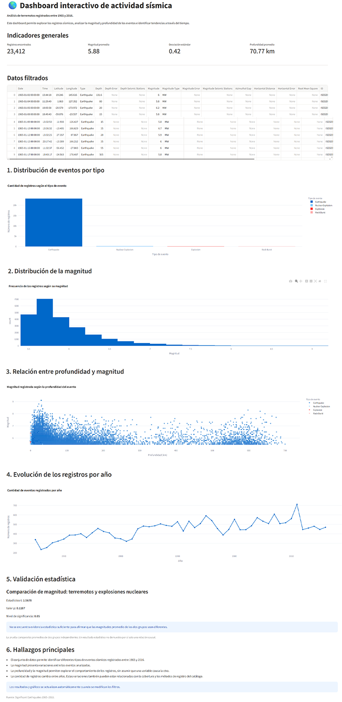

# Dashboard interactivo de actividad sísmica 1965–2016

## 1. Descripción del proyecto

Este proyecto presenta un dashboard interactivo desarrollado con Python y Streamlit para explorar el conjunto de datos **Significant Earthquakes 1965–2016**, que contiene registros de eventos sísmicos ocurridos durante ese periodo.

La aplicación permite consultar información mediante filtros, indicadores estadísticos, tablas y gráficos interactivos. Su propósito es comunicar los resultados del análisis exploratorio de datos de una manera clara y comprensible para estudiantes e investigadores.

## 2. Objetivo

Comunicar los resultados del análisis exploratorio de datos mediante una herramienta interactiva que facilite la comprensión de las características de los eventos sísmicos registrados entre 1965 y 2016.

## 3. Aplicación publicada

**Dashboard interactivo:**

https://dashboard-tarea4-emel.streamlit.app/

**Repositorio de GitHub:**

https://github.com/empev/dashboard-tarea4

## 4. Variables analizadas

- **Type:** tipo de evento sísmico.
- **Magnitude:** magnitud registrada del evento.
- **Depth:** profundidad del evento.
- **Date:** fecha del registro.

## 5. Funcionalidades del dashboard

- Filtro por tipo de evento.
- Filtro por rango de magnitud.
- Indicadores estadísticos: cantidad de registros, magnitud promedio, desviación estándar y profundidad promedio.
- Tabla interactiva de datos filtrados.
- Gráfico de distribución de eventos por tipo.
- Histograma de magnitudes.
- Diagrama de dispersión entre profundidad y magnitud.
- Gráfico de evolución anual de los eventos.
- Validación estadística mediante la prueba T de Welch.
- Interpretación de resultados y presentación de hallazgos.

## 6. Principales hallazgos del análisis

1. Los registros de terremotos presentan una magnitud promedio de aproximadamente 5,883, considerando 23.232 observaciones.
2. Los registros de explosiones nucleares presentan una magnitud promedio de aproximadamente 5,851, considerando 175 observaciones.
3. La prueba T de Welch obtuvo un estadístico de 1,5678 y un valor p de 0,1187. Como el valor p es superior al nivel de significancia de 0,05, no se encontró evidencia estadística suficiente para afirmar que las medias de magnitud de ambos grupos sean diferentes.
4. La correlación entre profundidad y magnitud fue de 0,023, lo que representa una relación lineal prácticamente inexistente en los registros analizados.

Estos resultados corresponden al conjunto de datos estudiado y no deben interpretarse como conclusiones universales sobre todos los terremotos.

## 7. Captura de pantalla

En esta sección se incorpora una captura de pantalla del dashboard publicado para mostrar su funcionamiento y presentación visual.


## 8. Tecnologías utilizadas

- Python.
- Streamlit.
- Pandas.
- NumPy.
- Plotly.
- SciPy.
- GitHub.
- Streamlit Community Cloud.

## 9. Estructura del repositorio

- `app.py`: código fuente de la aplicación.
- `requirements.txt`: dependencias necesarias.
- `README.md`: documentación del proyecto.
- `Significant Earthquakes 1965–2016.csv`: conjunto de datos utilizado.

## 10. Instalación y ejecución local

### Requisitos previos

- Python instalado.
- Conexión a Internet para instalar las dependencias.
- Git o descarga del repositorio.

### Pasos de instalación

1. Descargar o clonar el repositorio:

```bash
git clone https://github.com/empev/dashboard-tarea4.git
```

2. Ingresar a la carpeta:

```bash
cd dashboard-tarea4
```

3. Instalar las dependencias:

```bash
python -m pip install -r requirements.txt
```

4. Ejecutar el dashboard:

```bash
python -m streamlit run app.py
```

5. Abrir en el navegador la dirección local que aparece en la terminal, normalmente:

```text
http://localhost:8501
```

## 11. Despliegue en Streamlit Community Cloud

1. Ingresar a Streamlit Community Cloud.
2. Iniciar sesión con la cuenta de GitHub.
3. Seleccionar la opción para crear una nueva aplicación.
4. Elegir el repositorio `empev/dashboard-tarea4`.
5. Seleccionar la rama `main`.
6. Indicar `app.py` como archivo principal.
7. Iniciar el despliegue.
8. Verificar que la aplicación cargue correctamente y que los filtros y gráficos funcionen.

## 12. Solución de errores frecuentes

**Error: Streamlit no se reconoce como comando**

Ejecutar:

```bash
python -m pip install streamlit
```

**Error: No se encuentra el archivo CSV**

Verificar que el archivo `Significant Earthquakes 1965–2016.csv` esté ubicado en la misma carpeta que `app.py`.

**Error al importar SciPy**

Ejecutar:

```bash
python -m pip install scipy
```

También se debe comprobar que `scipy` esté incluido en `requirements.txt`.

**La aplicación no inicia**

Verificar que las dependencias estén instaladas y ejecutar nuevamente:

```bash
python -m streamlit run app.py
```

## 13. Autor y contexto académico

- **Estudiante:** Emel De Jesús Pedrozo Vásquez.
- **Programa:** Ingeniería de Sistemas.
- **Curso:** Programación para el análisis de datos.
- **Grupo:** 7.
- **Institución:** Universidad Nacional Abierta y a Distancia (UNAD).
- **Actividad:** Tarea 4 – Comunicación de resultados mediante dashboard interactivo.
- **Fecha:** noviembre de 2026.

## 14. Fuente de datos

Conjunto de datos: Significant Earthquakes 1965–2016.

El análisis y las visualizaciones se desarrollaron con fines académicos y de exploración de datos.
